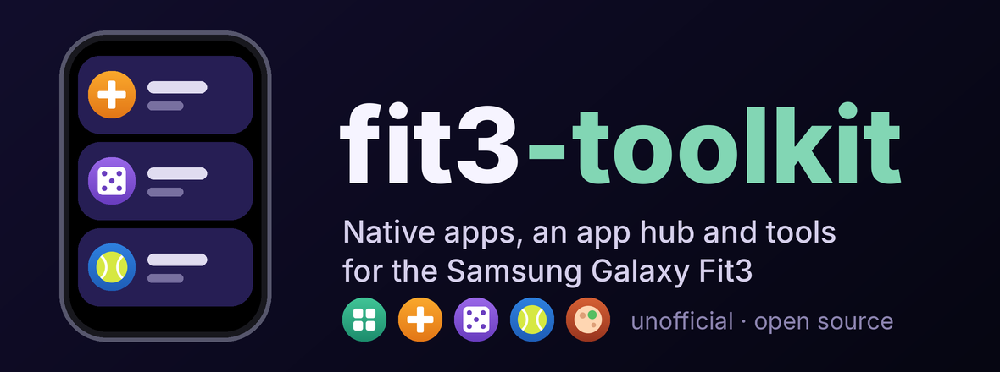
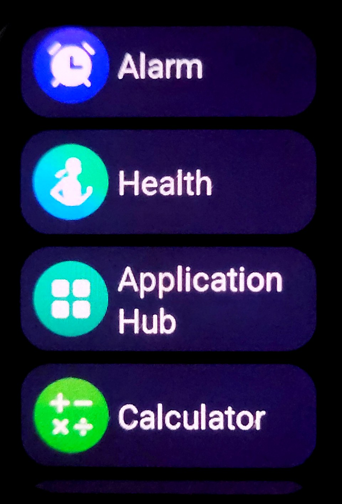
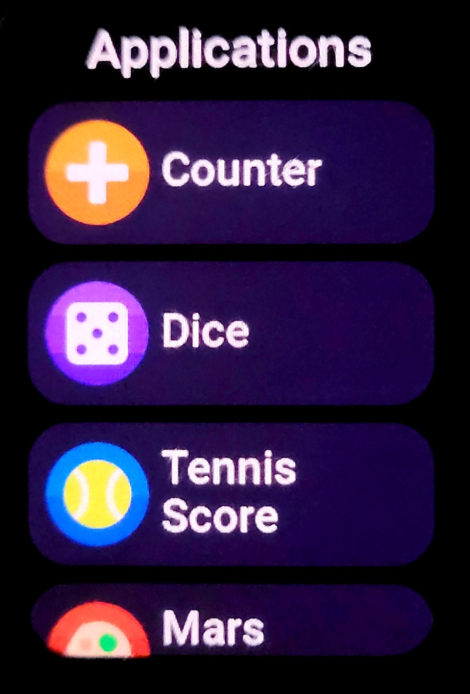
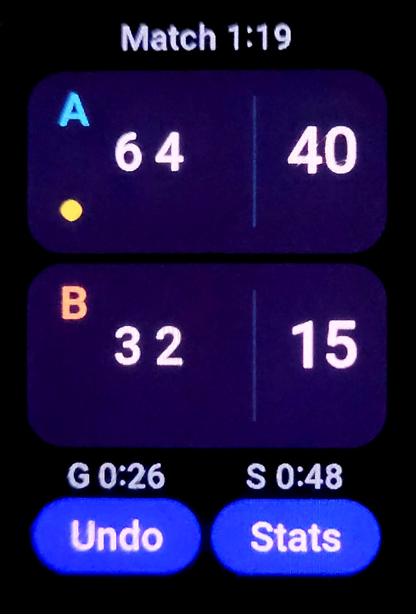
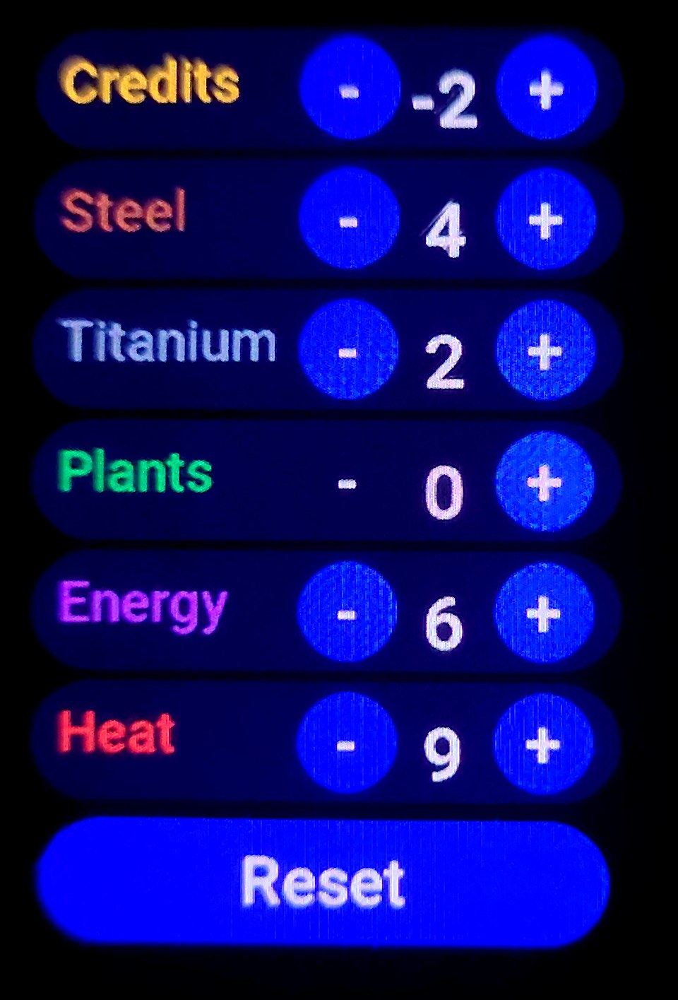
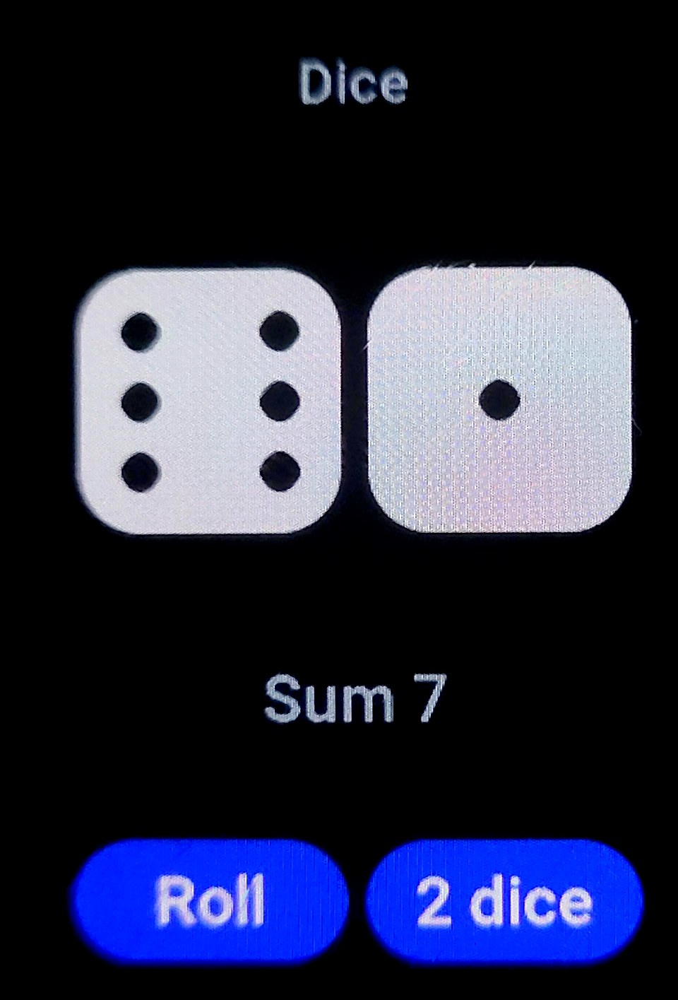
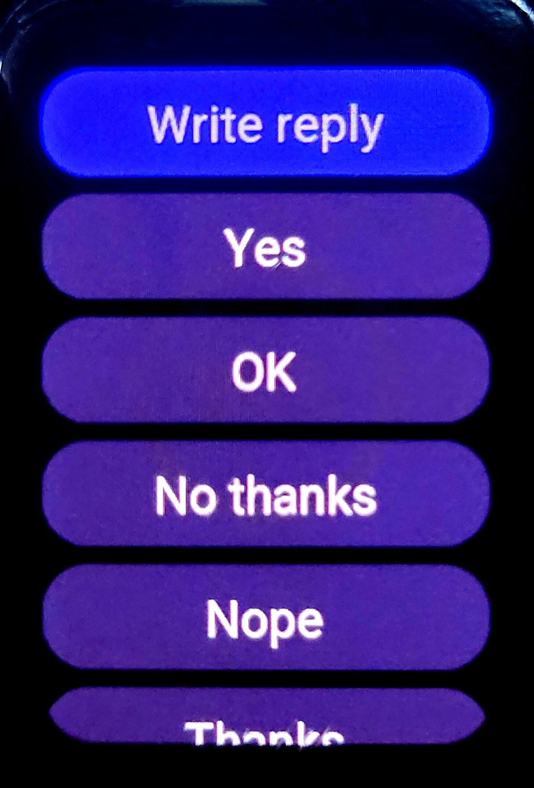
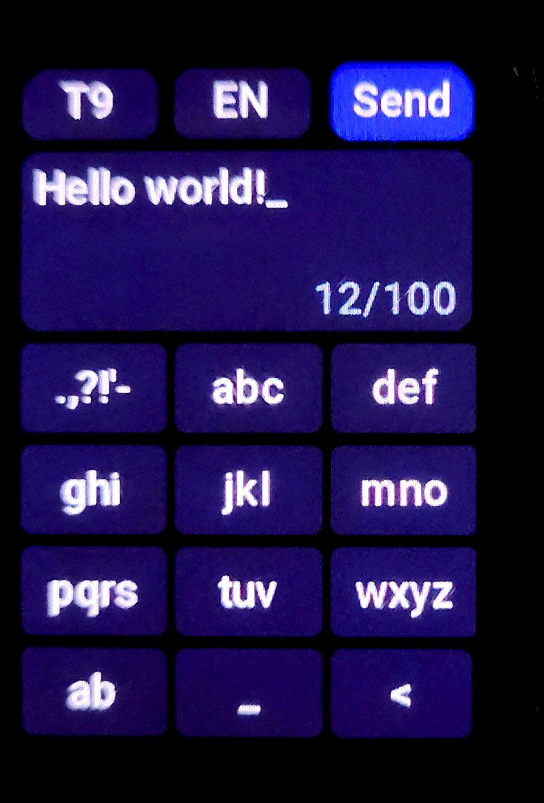
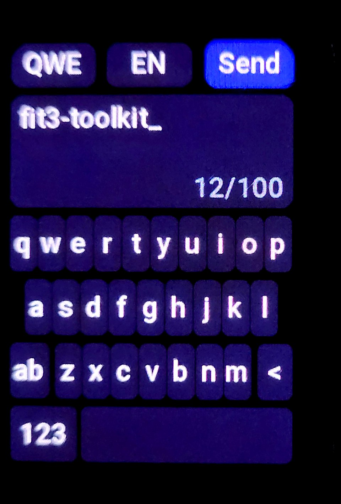

<p align="center">
  
</p>

<p align="center">
  
  
  
  
</p>

> [!NOTE]
> **This is a fork** of [yksen/fit3-toolkit](https://github.com/yksen/fit3-toolkit), not the original project. It adds:
> - **App Manager** ([`src/watch/apps/manager.c`](src/watch/apps/manager.c)): a page on the watch that lists the installed `.f3x` apps, checks their files and removes them.
> - **Benchmark** ([`src/watch/apps/bench.c`](src/watch/apps/bench.c)): measures CPU, file reads, drawing speed and heap, to judge whether a Game Boy emulator could run.
> - **Game Boy** ([`src/watch/apps/gameboy.c`](src/watch/apps/gameboy.c)): a Game Boy emulator app on [Peanut-GB](src/watch/apps/gb/README.md) (MIT). Bring your own games.
> - **Fit3 Apps** ([`android/`](android/README.md)): an Android app, in the watch's look, that installs and removes `.f3x` apps and sends a Game Boy ROM from the phone.
> - **Settings > Tips and tutorials** as an entry for the hub (`--slot "Tips and tutorials"`).
>
> The hub, the App Manager, the Benchmark and app installs from the phone ran on a watch; the Game Boy app has not yet (emulator tests only). Everything else is the upstream project, under its license.

> [!WARNING]
> **Unofficial and experimental. Not affiliated with Samsung.** Flashing firmware can leave a watch unusable. Read [docs/legal.md](docs/legal.md) first and keep the stock firmware at hand.

The Galaxy Fit3 has no SDK and no way to install apps. **fit3-toolkit puts your own native apps on it, and patches what the stock firmware does.** You build a firmware package from *your own* stock firmware with one command and flash it from your
PC over Bluetooth. Nothing of Samsung's is in this repository. The apps look and behave like stock ones: the firmware's own LVGL widgets and fonts, the stock slide animations, the side key, the back gesture.

<table width="100%">
  <tr>
    <td width="25%" align="center"><br><sub>Hub in the app list</sub></td>
    <td width="25%" align="center"><br><sub>The Application Hub</sub></td>
    <td width="25%" align="center"><br><sub>Tennis Score</sub></td>
    <td width="25%" align="center"><br><sub>Mars Production</sub></td>
  </tr>
  <tr>
    <td width="25%" align="center"><br><sub>Dice</sub></td>
    <td width="25%" align="center"><br><sub><i>Write reply</i> above the quick replies</sub></td>
    <td width="25%" align="center"><br><sub>Reply keyboard: T9</sub></td>
    <td width="25%" align="center"><br><sub>Reply keyboard: QWERTY</sub></td>
  </tr>
</table>

## Features

- **Application Hub**: one entry of the stock app list becomes a native-style list of your apps. Open one and it slides in like a stock app; swipe back to leave.
- **Install apps without flashing**: `.f3x` files go to the watch over Bluetooth in about a second. A long press on an app's row removes it.
- **Reply keyboard** (a firmware patch, not an app): a *Write reply* row on the page of quick replies of a notification opens a keyboard, QWERTY or T9 multi-tap, with the letters of your language; the text goes to the phone as the reply. Layouts for 24 Latin-script languages, chosen at build time and followed from the watch's system language. [docs/replies.md](docs/replies.md)
- **Demo apps** you can use or copy: *Tennis Score*, *Counter*, *Dice*, *Mars Production*. Each can be built into the firmware or installed later.
- **Tools**: build and validate firmware packages, flash them, install apps, an emulator that runs the real firmware's functions on your PC, decoders for the watch's fonts and images.

Tested on one SM-R390 with firmware **R390XXU0AZA3** only; the build refuses anything else. **Your watch must be on exactly this version** (check: band Settings > About band > Software information, or Galaxy Wearable > Band settings > About band > Software information; details in [docs/howto.md](docs/howto.md#check-your-firmware-version)). What was actually seen on a watch: [docs/status.md](docs/status.md).

## Quick start

You need the stock package for R390XXU0AZA3 (keep a copy), `arm-none-eabi-gcc`, Python 3 with numpy and Pillow, and a watch charged to 50 % or more. Flashing and installing apps also need a Bluetooth
adapter: the link uses Python's RFCOMM sockets and was **tried on Linux only** (building, the emulator and the tests need no Bluetooth and no watch). Full steps: [docs/howto.md](docs/howto.md).

**1. Build and flash the hub**

```sh
python3 -I src/build_firmware.py stock-aza3.bin hub.bin --hub none
export F3_ADDR=AA:BB:CC:DD:EE:FF                      # your watch's Bluetooth address
python3 -I src/device/f3_flash.py hub.bin --upload --verify --start-update    # asks you to type FLASH
```

**2. Install apps (no flashing)**

```sh
python3 -I src/f3x/build_f3x.py src/watch/apps/mars.c mars.f3x --icon-kind mars
python3 -I src/device/f3x_install.py install mars.f3x
python3 -I src/device/f3x_install.py list
```

**3. Reply keyboard** (optional; a firmware patch, rebuild the package with it)

```sh
python3 -I src/build_firmware.py stock-aza3.bin hub.bin --hub none --reply-keyboard --kb-lang pl,en    # the layouts you want, or all; needs Roboto (fc-match) for the font
```

**4. Write your own** &nbsp;(start from the smallest complete app, [`counter.c`](src/watch/apps/counter.c); the guide is in [src/watch/apps](src/watch/apps/README.md))

```sh
cp src/watch/apps/counter.c src/watch/apps/myapp.c       # edit, then build it as in step 2
```

> [!IMPORTANT]
> On a watch that has only ever run Samsung's firmware, the first flash needs a **factory reset**. The default build also carries two Bluetooth patches that let *anyone in range* connect to the watch
> without pairing; build your final package with `--no-bluetooth-patches` (installed apps keep working, but you cannot add more without flashing again). Both are explained in [docs/howto.md](docs/howto.md).

## Repository layout

```text
src/
├── build_firmware.py     one command: your stock package -> a package with the hub or an app
├── watch/                the code that runs on the watch
│   ├── hub.c             the Application Hub: window, list, loader of installed apps
│   ├── kbd.c, kblang.py  the reply keyboard and its layouts per language
│   ├── ui.h              shared header: firmware functions, colours, fonts, widgets
│   └── apps/             demo apps (Tennis Score, Counter, Dice, Mars Production) and the guide to writing your own
├── f3x/                  the .f3x app format and its builder
├── device/               talk to the watch: flash a package, install apps, copy fonts and images off it
├── firmware/             read, patch, validate and rebuild firmware packages
├── emu/                  run functions of the real firmware on the PC; screenshots; most of the tests
├── assets/               decoders for fonts, images and language packs; icon generator
└── re/                   the Ghidra pipeline used to study the firmware
docs/
├── howto.md              the full procedure, step by step
├── status.md             what was tried on a watch, and what was not
├── f3x.md                the .f3x file format
├── replies.md            writing your own reply to a notification (keyboard, QWERTY and T9)
├── details.md            how the firmware works: addresses, windows, fonts
├── firmware.md           the package format
├── protocol.md           the Bluetooth file-transfer protocol
├── assets.md             the watch's fonts and image packs
├── legal.md              disclaimer, credits, what is not in the repository
└── symbols.csv           named firmware addresses
```

Every directory under `src/` has its own README.

## How it works

The firmware calls two functions of each window of its app list through a table. The build puts a branch at the start of those two functions of the chosen entry, into our code in an empty area of the
firmware image (62 KB of zeros). The reply keyboard is the same idea at two other places: the two calls that build the page of quick replies go through our code, which adds a row. Our code calls the firmware's own LVGL functions and answers the window manager's questions. Each app opens as a window of its own, so the manager animates it. Nothing
runs at boot: a mistake shows only when the entry is opened, and the watch still boots and can be flashed again. Addresses and details: [docs/details.md](docs/details.md).

## Credits

Repositories we learned from and used while developing this project. Nothing of their code is in this repository.

| Project | What we took from it |
|---|---|
| [Musicalista/fit3-store-apps-games](https://github.com/Musicalista/fit3-store-apps-games), [Musicalista/freemyfit3](https://github.com/Musicalista/freemyfit3) | a reference for the two Bluetooth patches that make the watch reachable from a PC (we compared their patched package with the stock one and reproduce the two changes ourselves), Neither repository has a license, so we used facts only, wrote our own code and made our own app format (`.f3x`, unrelated to their `.f3a`) |
| [yuriyurin/fit3-flasher](https://github.com/yuriyurin/fit3-flasher) | the Bluetooth transfer protocol and the rules for validating a firmware package ([`src/firmware/validate_fwd.py`](src/firmware/validate_fwd.py) re-implements its checks) |
| [LVGL](https://lvgl.io) | the library the watch's UI is built on; its public sources were our reference for the structures and functions we call |
| [Ghidra](https://ghidra-sre.org) | the analysis of the firmware ([`src/re/`](src/re/README.md)) |
| [Unicorn](https://www.unicorn-engine.org) | the CPU emulator under [`src/emu/`](src/emu/README.md) |

Terms of each, as far as we know, and what is not in this repository: [docs/legal.md](docs/legal.md).

## AI Disclaimer

This project was developed with [Claude Code](https://claude.com/claude-code) (Anthropic): writing code, debugging, reverse-engineering the firmware, tests and documentation. The AI can make mistakes, so read the code before you run it, and trust [docs/status.md](docs/status.md) (what was seen on a watch) more than a
comment. More in [docs/legal.md](docs/legal.md).

## License

[Apache License 2.0](LICENSE) for everything in this repository (code, notes, our icons, the banner and the photos of the screen). It covers only what we wrote: the stock icons and fonts that are visible in a photo of the watch stay Samsung's. It gives you no rights to Samsung's firmware,
fonts or images, which you must bring from your own watch, and it does not change the terms of the projects credited above.
