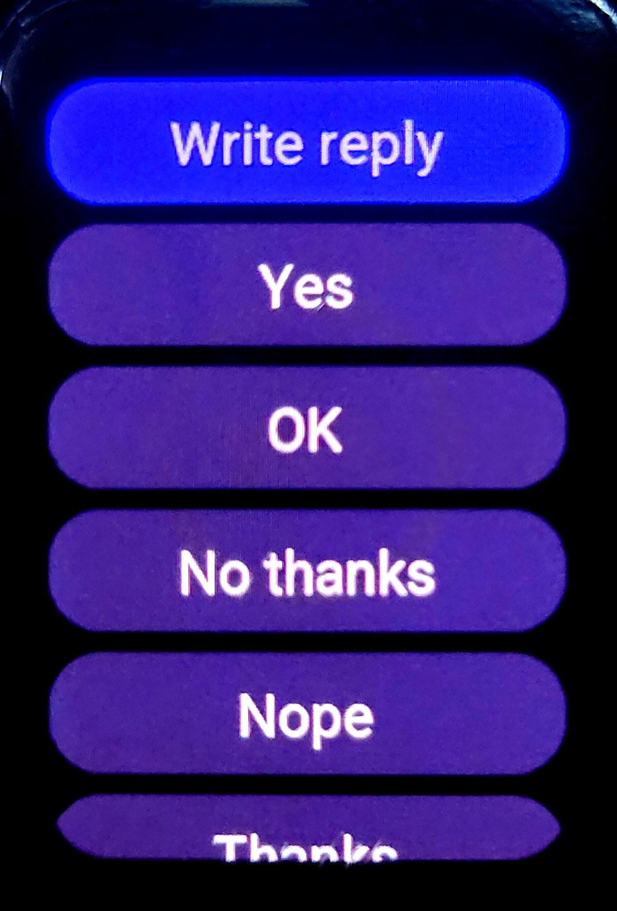
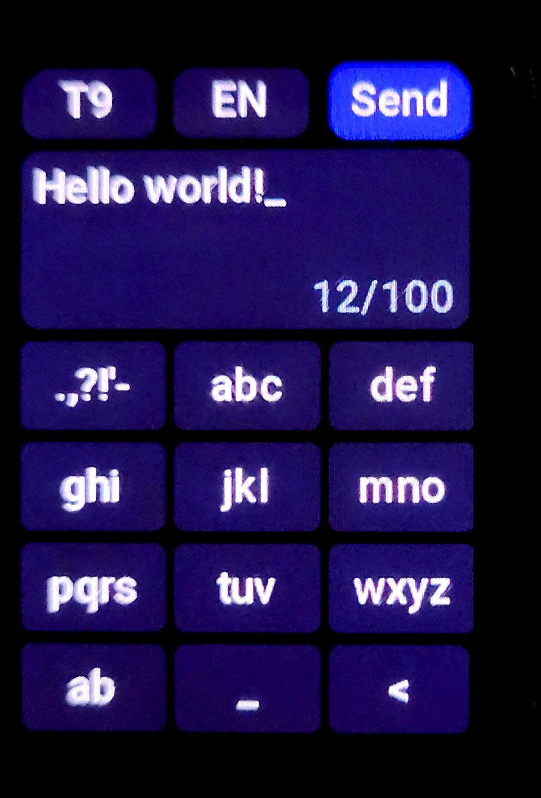
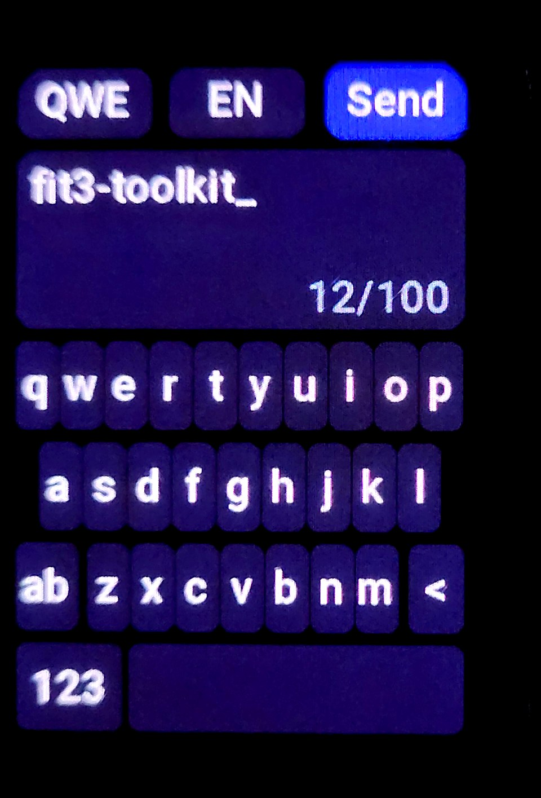

# Writing your own reply to a notification

The watch already answers notifications from a list of **quick replies** (the texts you set up in the phone app). `--reply-keyboard` adds a row **Write reply** on top of that list. It opens a
keyboard window; **Send** hands the text to the firmware's own reply sender, the function the stock reply rows end in. Nothing else of the notification code is replaced.

> **State: built and tested in the emulator; two live tests found a hook in the wrong place (fixed, seen working), a wrongly narrow check of the argument block and a row that was too high (both fixed, not yet seen on a watch again).** The open question is on the phone: whether the Samsung app on the phone accepts a text that is not one of its own list.
> See [Status](#status) before you rely on it.

<table width="60%">
  <tr>
    <td width="33%" align="center"><br><sub>Write reply, above the quick replies</sub></td>
    <td width="33%" align="center"><br><sub>T9</sub></td>
    <td width="33%" align="center"><br><sub>QWERTY</sub></td>
  </tr>
</table>

```sh
python3 -I src/build_firmware.py local/firmware/stock-aza3.bin local/firmware/fit3-hub-reply.bin --hub counter,dice --reply-keyboard --kb-lang pl,en
```

It works with every build mode (`--app`, `--hub`). The font is Roboto Medium, found with `fc-match` or given with `--kb-font <file.ttf>`; it is Apache-2.0 and not stored in the repository, the
generated glyph tables go into the package.

## Languages

`--kb-lang` chooses the layouts that are built in: `en` (the default), `pl`, `pt`, `es`, `fr`, `de`, `it`, `nl`, `cs`, `sk`, `hu`, `hr`, `sl`, `ro`, `sv`, `nb`, `is`, `tr`, `lt`, `lv`, `et`, `ca`, `ga`, `sq`, or `all`; give several, comma-separated (`--kb-lang pl,en`). Each layout is a letter layout (QWERTY, QWERTZ or AZERTY), the letters it lacks on a layer of their own (the key after `123`, captioned with the first two) and the multi-tap groups of the T9 pad, made from the extra letters (ą with `a`, ł with `l`, ...). The capitals follow the language (Turkish `i` gives `İ`). The font holds exactly the characters of the chosen layouts.

With more than one layout the keyboard picks the one of the **watch's system language** (a byte in the firmware, `0x200fafe0`, an index into its 69 language packs; the language packs of one layout are, for example, `pt_rBR` and `pt_rPT`); a language without a layout of its own gets the first one of the list. The language button in the header (`PL`, shown only when the build has more than one layout) switches to the next layout, and the choice is remembered (`/user/kbd.sav`, 4 bytes together with the QWERTY/T9 switch). Not covered: scripts that need another layout and font (Cyrillic, Greek, Arabic, Hebrew, Indic, CJK, Thai, Vietnamese).

Cost against a hub with no apps, measured: `en` 10 kB of the free flash, `pl,en` 12 kB, all 24 layouts 25 kB (most of it the font and the tables).

## What you get

- **Write reply** as the first row of the page of quick replies (also when you have no stored replies).
- **QWE**: the letter layout of the language with a symbol layer (`123`) and a layer of the language's extra letters (in Polish `ąć`: ą ć ę ł ń ó ś ź ż), with capitals from the shift key. One tap on shift is one capital; a new text and the first letter after
  `. ` `! ` `? ` start with a capital.
- **T9**: phone-style multi-tap on a 3 x 4 pad, no dictionary. In Polish `2` is `a b c ą ć 2`, `3` is `d e f ę 3`, `5` is `j k l ł 5`, `6` is `m n o ń ó 6`, `7` is `p q r s ś 7`, `9` is `w x y z ź ż 9`, `1` is `. , ? ! ' - 1`,
  `0` is a space and `0`; other languages add their letters the same way (a caption shows at most six characters, the rest are still in the cycle). The same key again within 0.9 s replaces the last character with the next one of its group. The switch at the top left changes the layout; the choice is saved
  (4 bytes, `/user/kbd.sav`).
- A count of the bytes used, `13/100`, in the bottom right corner of the text field (the limit is **100 bytes**, as in the stock buffer; a Polish letter is two). The field shows the last two lines of the text. Past the limit a key buzzes and adds nothing.
- **Send** with no phone link tells you so and keeps the text; after a send the window says "Sent" and goes back. The back gesture leaves without sending.
- No text prediction and no autocorrection on purpose: a dictionary would take much of the free flash that the apps use.

## How it is wired

| Part | What |
|---|---|
| Hooks | **two** places build the stock page, and both are pointed at `src/watch/kbd.c`, which calls the stock builder and then adds the row (`build_package.py` checks the stock bytes of both sites). The page the reply icon opens is `0x2c1d09d0`, reached through one tail call (`b.w` at `0x2c1d0f92`); when the phone sends new replies while the page is open (event `0x42`) the screen is rebuilt by `0x2c1d0b94` (`bl` at `0x2c1d2598`). A first version hooked only the second one: the row then appeared only after such a refresh, never on a normal open. |
| Row | 254 x 76 card like the stock rows, placed above them (their positions are fixed once, so they are moved down by hand). |
| Window | a record of our own, id `0x9c` (zeros in the flash, like `0x10`), filled when the first row is shown; the same window rules as the hub's windows. |
| Data | the row looks up the current notice exactly like the stock reply rows (`0x2c0ed1f8`), reads its `seq_id` (record `+0x124`) and passes a small block to the window through `wm_open`. |
| Send | `0x2c112f58(seq_id, text, length)`, checked first against the phone link (`0x2c0e6ef4`). |

Details of the firmware side: [details.md](details.md), section 8. Code: [`src/watch/kbd.c`](../src/watch/kbd.c), layouts [`src/watch/kblang.py`](../src/watch/kblang.py), font generator [`src/assets/mkfont.py`](../src/assets/mkfont.py).

## Status

| What | State |
|---|---|
| Layouts per system language (the byte at `0x200fafe0` is the language number: ids 8, 18, 56, 61 that the firmware treats as right-to-left are Arabic, Persian, Urdu, Hebrew), the language button, saved choice, Turkish capitals, AZERTY and QWERTZ, two-row extra layers, multi-tap groups of French, rounder-corners fix | emulator (`test_kbd.py`, `test_kblang.py`); the look, the layouts and the language button were seen on the watch (2026-11-02); that the *system* language picks the layout is not yet reported |
| Both hooks run against the real stock builders; the added row (with replies and without, after the reply icon's page and after a refresh, once), the tap, the window, QWERTY, symbols, Polish letters, shift, multi-tap, delete of two-byte letters, the 100-byte limit, no phone, back gesture, bad arguments, what goes to the sender (`src/emu/test_kbd.py`, 82 checks) | emulator |
| The static font renders every Polish letter and ASCII (`src/emu/test_font.py`, `src/assets/test_mkfont.py`) | emulator |
| `build_package.py`: the call site is the only change outside the free flash (`test_build_package.py`) | PC |
| Layout of the keyboard, key size, how it looks next to the stock rows | watch (2026-11-02: "looks great"); emulator pictures (`src/emu/screenshot_kbd.py`); in them the first key of the pad is drawn without its box (the label is there); the photos show the box on the watch, so that is an artifact of the emulator's renderer, not of our code |
| Both hooks: "Write reply" is the first row on every opening of the reply page (SMS) | watch (2026-11-02) |
| Window id `0x9c` accepted by the window manager: a tap on the row opens our window | watch (2026-11-02); the first version showed its error screen, because it accepted the argument block only below `0x20800000` and the watch's heap is elsewhere; fixed, the error screen now shows the value it got |
| The row has the height of the stock rows (they are as high as their text); the first version had a fixed 76 px | watch: it looked taller; fixed from the stock builder's `LV_SIZE_CONTENT` |
| The record of the notice is found with the globals the stock rows use, and `seq_id` is at `+0x124` | watch (2026-11-02): replies reached the phone on SMS and Signal |
| The phone accepts our text and shows it as the reply | watch (2026-11-02): SMS and Signal. That Polish letters (two UTF-8 bytes each) arrive intact in the conversation is **not yet confirmed** |
| What the stock path does after a send (marks the notice as answered, shows its own confirmation) is **not** repeated: we show "Sent" and go back | open |

## The test on a watch

Only after a decision to flash. Steps, from the least to the most risky: (1) flash the package built above (the same kind of package as the hub's, validated by the build); (2) get a notification
that can be answered on the phone (a chat message) and open its reply page: **Write reply** must be the first row and the stock rows must follow; (3) type `test` and send: the phone should show it
as a reply; (4) type `zażółć gęślą jaźń` and send, to see whether the phone keeps the Polish letters; (5) try T9. If (2) already fails, nothing was sent. Nothing in this feature writes to the
watch's files except the 4-byte mode file.
